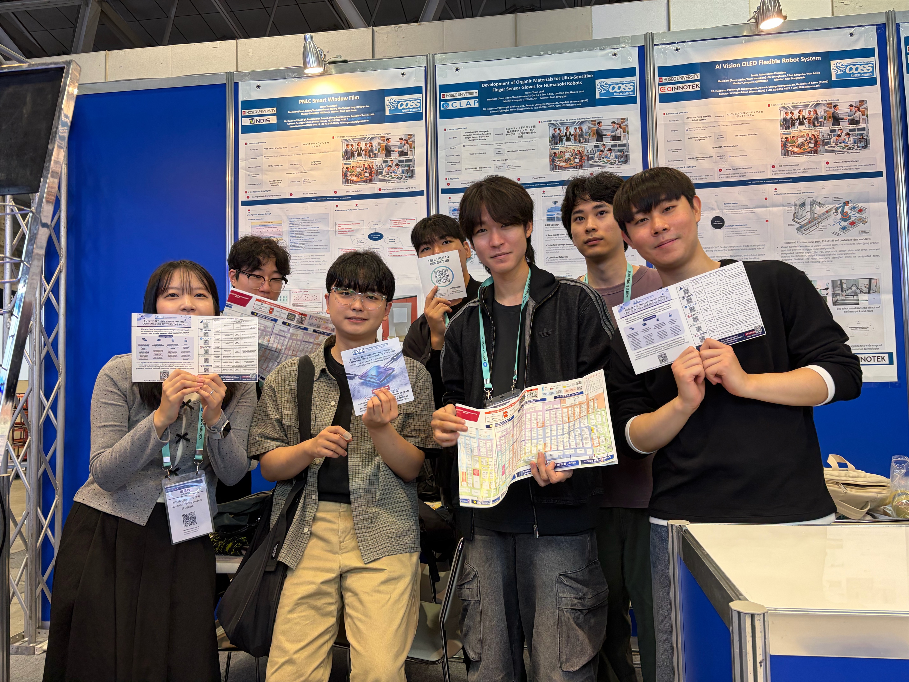

# 서지혜 · Seo Jihye

**산업 문제를 데이터와 모델로 검증하는 AI/ML 엔지니어를 지향합니다.**

배터리 시계열 예측과 컴퓨터 비전을 중심으로, 데이터 조건이 달라질 때의 성능 변화와 실제 사용 환경의 제약을 함께 살펴봅니다. 모델 비교·반복 실험부터 추론 코드와 시연 화면까지 연결하고, 결과를 확인할 수 있는 코드와 자료를 공개합니다.

[이메일](mailto:alflwlgp85@naver.com) · [배터리 연구](https://github.com/seojeejee/physics-guided-marine-battery-soc) · [컴퓨터 비전](https://github.com/seojeejee/jetson-safety-zone-intrusion-detection) · [서비스 구현](https://github.com/seojeejee/MOVE-AI)

## 대표 프로젝트

| 프로젝트 | 핵심 경험 | 확인 가능한 결과 |
| --- | --- | --- |
| [배터리 SOC 추정](https://github.com/seojeejee/physics-guided-marine-battery-soc) | 물리 기반 데이터 생성, TCN, 반복 실험 | 해양 프록시 MAE **1.808 → 1.024%p**, 5개 시드 모두 개선 |
| [Jetson 안전구역 침범 탐지](https://github.com/seojeejee/jetson-safety-zone-intrusion-detection) | YOLO11, 다각형 영역 판정, TensorRT 변환 | 보관된 학습 결과의 **mAP@0.5 0.795**, 추론·변환 코드 공개 |
| [MOVE AI · 길새김](https://github.com/seojeejee/MOVE-AI) | GPS·GeoJSON 처리, 관리자 검증 흐름, 웹 시연 | 팀 프로젝트의 구현 기여와 실행 가능한 데모 정리 |
| [FINETECH · 로봇 센서 소재](./projects/finetech-2026.md) | 유기전자 소재·잉크젯 공정 학습, 산학 협업 | 연구 포스터와 전시 현장 자료 4종 |
| [뉴스 진위 판별 RAG 챗봇](https://github.com/seojeejee/news-verification-rag-chatbot) | KoBERT·KcELECTRA, RAG 검색·요약, Flask API | 뉴스 12,559건 전처리와 공개용 코드 아카이브 |
| [JKIT-128-1 임베디드 실험](https://github.com/seojeejee/jkit-128-embedded-labs) | AVR C, 외부 인터럽트, 타이머, 7-세그먼트·부저 | 주차별 실험과 2인 숫자 정지 게임 펌웨어 |

### 01. 배터리 SOC 추정 · 산업 시계열 연구

차량 데이터로 학습한 모델이 해양 프록시 조건에서 겪는 오차 증가를 측정하고, 물리 기반 데이터 보강의 효과를 검토했습니다.

- **구현:** 공개 데이터별 물리 특성을 분리한 프록시 생성, TCN 학습·평가, 결과 대시보드
- **검증:** 원천 시퀀스 단위 분할, 검증셋 기반 조건 선택, 5개 시드 반복 평가
- **결과:** 해양 프록시 SOC MAE **1.808%p → 1.024%p**. 공개 데이터 기반 내부 검증이며 실제 선박 계측 데이터 검증은 후속 과제입니다.

[코드와 실행 방법](https://github.com/seojeejee/physics-guided-marine-battery-soc) · [결과 원본](https://github.com/seojeejee/physics-guided-marine-battery-soc/blob/main/reports/gpu_tcn_final_robustness/robustness_report.json)

### 02. Jetson 안전구역 침범 탐지 · 컴퓨터 비전

버스와 보행자를 탐지하고, 보행자의 발 위치를 기준으로 가상 안전구역 침범을 판정하는 엣지 AI 프로토타입입니다.

- **구현:** YOLO11 추론, 다각형 영역 판정, 카메라·영상 입력, TensorRT FP16 변환 경로
- **분석:** 전체 mAP@0.5 **0.795**와 Person AP@0.5 **0.614**를 함께 보고, 작은 객체·가림과 미탐 문제를 후속 개선 대상으로 정리
- **검증 범위:** 보관된 학습 산출물을 기반으로 정리했습니다. 장치 FPS·지연시간·전력은 실측 자료가 없어 성과 수치로 제시하지 않습니다.

[코드와 실행 방법](https://github.com/seojeejee/jetson-safety-zone-intrusion-detection) · [실험 해석](https://github.com/seojeejee/jetson-safety-zone-intrusion-detection/blob/main/docs/EXPERIMENTS.md)

### 03. MOVE AI · 현장 데이터를 서비스로 연결

운송자의 현장 경험을 GPS·제보와 연결하고, 관리자 확인을 거쳐 다음 운행에 재사용하는 팀 프로젝트입니다.

- **참여:** 모바일 웹 프로토타입, GPS·GeoJSON 파이프라인 통합, 사진·음성 제보, 관리자 검증 흐름과 Streamlit 배포 번들 구현
- **설계:** 감지된 행동을 확인 후보로 처리하고, 안전 정차 후 질문과 관리자 승인을 거쳐 지식으로 전환
- **시연 범위:** AI 구조화와 이동·ETA는 시연용 로직입니다. 개인 포크에 원 팀 저장소와 공동 작업 이력을 연결했습니다.

[구현 기여와 실행 방법](https://github.com/seojeejee/MOVE-AI) · [시연 흐름](https://github.com/seojeejee/MOVE-AI/blob/main/DEMO_SCRIPT.md)

### 04. FINETECH JAPAN 2026 · 산학 연구와 기술 교류

호서대학교 × ㈜클랩의 Team CLAP 팀원으로 참여했습니다. 휴머노이드 로봇용 유연 센서 소재와 잉크젯 공정을 공부하고, 로봇 손에 적용하는 센서 글로브를 주제로 전시를 준비했습니다.

- DPP 유기반도체, SBS 절연체, 아자이드 가교와 인쇄·건조 조건 학습
- 소재·공정·계면의 관계를 기술 질문으로 정리하고 연구 배경을 포스터로 전달

**Team CLAP 전시 참여 기록** · [연구 내용과 관련 문헌](./projects/finetech-2026.md) · [포스터와 현장 자료 4종](./projects/finetech-2026.md#전시-자료)

### 05. 뉴스 진위 판별 RAG 챗봇 · 프로젝트 기반 SW 교육

2025년 1학기 호서대학교 컴퓨터공학과 학생들과 팀을 이루어 뉴스 본문과 관련 기사를 함께 분석하는 진위 판별 챗봇을 구현했습니다. 과학기술정보통신부 지원 이노베이션아카데미의 코디세이(Codyssey)를 활용한 15주 PBL 정규교과에서 진행했습니다.

- **데이터:** Clickbait 5,507건과 NonClickbait 7,052건의 JSON 본문을 추출·정제하고 이진 분류 데이터셋 구성
- **구현:** KoBERT·KcELECTRA 기반 분류 실험, 네이버 뉴스 검색, 벡터 검색, KoBART 요약과 RAG 보조 판정 결합
- **시연:** Flask `/verify` API로 뉴스 입력, 관련 문서 요약과 진위 확률을 반환하는 흐름 구현
- **공개 범위:** 인증정보와 실행 출력을 제거한 노트북을 공개했습니다. 최종 성능 수치와 일부 보조 모듈·모델 가중치는 보관 자료에 없어 재현 범위를 명시했습니다.

[코드와 프로젝트 설명](https://github.com/seojeejee/news-verification-rag-chatbot) · [교육과정 공식 소개](https://www.innovationacademy.kr/academy/board/read?boardManagementNo=2&boardNo=330&level=2&menuNo=16&page=&searchType=&searchWord=)

### 06. JKIT-128-1 임베디드 실험 · 2인 숫자 정지 게임

정규 실험에서 LED·스위치·부저·7-세그먼트와 외부 인터럽트·타이머 제어를 단계별로 익혔습니다. 기말 프로젝트에서는 두 플레이어가 증가하는 숫자를 버튼으로 멈추고 값을 비교해 먼저 4점을 얻는 게임을 AVR C로 구현했습니다.

- **입출력:** 4자리 7-세그먼트 멀티플렉싱, LED 점수판, 두 개의 외부 인터럽트 버튼
- **제어:** 버튼 디바운싱, 플레이어별 숫자 정지와 비교, 라운드·최종 승패 상태 관리
- **사운드:** Timer3 부저 주파수 생성과 Timer0 기반 배경음·버튼음·승패 멜로디 구성
- **공개 범위:** 주차별 실험·기말 프로젝트 노트북과 최종 펌웨어 `src/main.c`를 공개했습니다.

[실험 노트북과 기말 프로젝트 코드](https://github.com/seojeejee/jkit-128-embedded-labs)

## 기술과 적용 경험

| 영역 | 사용 기술 | 적용 경험 |
| --- | --- | --- |
| 시계열·머신러닝 | Python, PyTorch, NumPy, pandas, scikit-learn | SOC 추정, TCN 학습, 분할·반복 실험 |
| 컴퓨터 비전·엣지 | YOLO11, OpenCV, TensorRT | 객체 탐지, 안전구역 판정, Jetson 배포 경로 |
| 데이터·프로토타입 | JavaScript, GeoJSON, SQLite, Streamlit | 위치 데이터 처리, 관리자 검증 UI, 결과 시연 |
| 자연어 처리·검색 | KoBERT, KcELECTRA, KoBART, RAG, Flask | 뉴스 분류, 관련 문서 검색·요약, API 시연 |
| 임베디드 시스템 | AVR C, 외부 인터럽트, 타이머, 7-세그먼트 | JKIT 입출력 실험, 2인 게임 펌웨어 |
| 융합 연구 | 유기전자 소재, 잉크젯 공정 | 로봇 센서 소재 검토와 전시 자료 작성 |

## 자격

- **SQL 개발자(SQLD)** · 한국데이터산업진흥원 · 2025.09 취득

## 연락처

산업 AI/ML·배터리 시계열·컴퓨터 비전 분야의 인턴십, 연구 및 프로젝트 협업에 관심이 있습니다.

[alflwlgp85@naver.com](mailto:alflwlgp85@naver.com)
