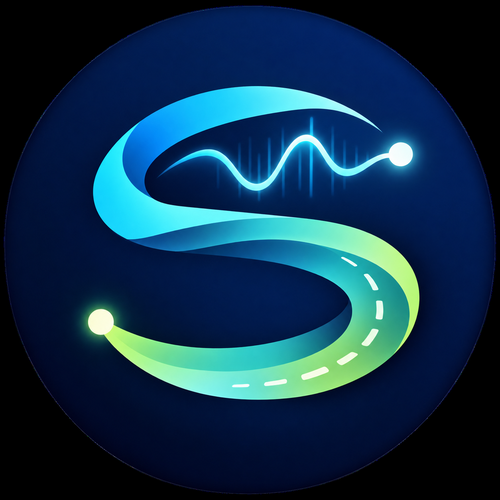

# 서지혜 · Seo Jihye

**Applied AI/ML Engineer** focused on battery intelligence, edge vision, and reliable decision-support systems.

현실의 물리 제약과 운영 환경을 AI 모델에 반영하고, 실험 결과를 재현 가능한 코드와 실제로 확인할 수 있는 프로토타입으로 구현합니다.

## Featured Projects

### [Physics-Guided Marine Battery SOC](https://github.com/seojeejee/physics-guided-marine-battery-soc)

공개 배터리 데이터와 물리 기반 해양 프록시를 결합한 시계열 SOC 추정 연구입니다.

- 해양 프록시 SOC MAE **1.808%p → 1.024%p**
- 5개 random seed에서 모두 성능 개선
- GRU, TCN, Tiny Transformer, CNN-Attention-LSTM 비교 파이프라인 구축
- 데이터 누수를 방지한 split과 물리 제약·데이터 품질 검증
- Streamlit 기반 실험 결과 대시보드 구현

`Python` `PyTorch` `GRU` `TCN` `Time Series` `Battery AI` `Scientific ML`

### [Jetson Safety-Zone Intrusion Detection](https://github.com/seojeejee/jetson-safety-zone-intrusion-detection)

YOLO11 객체 탐지와 다각형 안전구역 판정을 결합한 Jetson 엣지 AI 프로토타입입니다.

- 전체 mAP@0.5 **0.795**, mAP@0.5:0.95 **약 0.609**
- Bus AP@0.5 **0.975**, Person AP@0.5 **0.614**
- TensorRT FP16 변환 및 실시간 카메라 추론 경로 구현
- 학습 결과와 모델 한계, 후속 실험 방향 문서화

`Python` `YOLO11` `TensorRT` `Jetson` `OpenCV` `Edge AI`

### [MOVE AI · 길새김](https://github.com/seojeejee/MOVE-AI)

운송자의 현장 판단을 데이터로 기록하고 관리자 검증을 거쳐 다음 운행에 활용하는 팀 프로젝트입니다.

- GPS 반경 필터와 GeoJSON 지오펜스 구현
- 시설 진입·대기·이탈 및 속도 이상 후보 탐지
- 사진·음성 제보와 관리자 승인 워크플로 구성
- 모바일 우선 웹 UI와 Streamlit 배포 환경 구축

`Python` `JavaScript` `GeoJSON` `SQLite` `Streamlit`

## Skills

- **AI and Machine Learning:** PyTorch, YOLO, GRU, TCN, model evaluation, physics-guided learning
- **Edge and Computer Vision:** TensorRT, Jetson, OpenCV, real-time inference
- **Data and Backend:** NumPy, pandas, scikit-learn, REST API, SQLite, GeoJSON
- **Delivery:** Streamlit, reproducible experiments, technical documentation

## Engineering Approach

- 데이터 출처와 평가 조건, 모델의 한계를 결과 수치와 함께 공개합니다.
- 모델 선택과 최종 평가를 분리하고 반복 실험으로 결과의 안정성을 확인합니다.
- 실제 사용 환경과 안전 요구를 고려해 AI와 규칙 기반 로직의 역할을 구분합니다.

## Current Focus

Marine battery SOC modeling, multi-seed model comparison, edge deployment, and trustworthy AI systems.

## Contact

AI/ML, Edge AI, Battery Intelligence 분야의 인턴십, 프로젝트 협업 및 채용 제안을 환영합니다.

- **Email:** [alflwlgp85@naver.com](mailto:alflwlgp85@naver.com)
