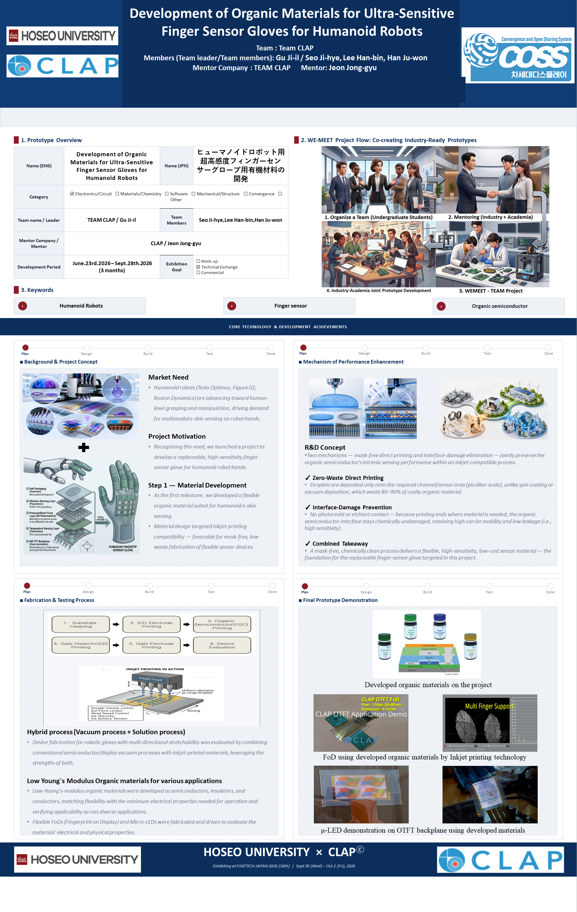
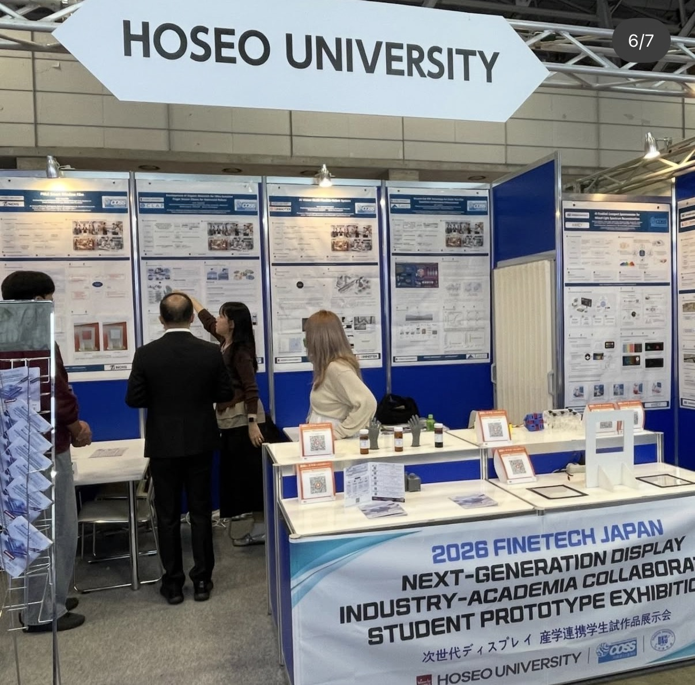
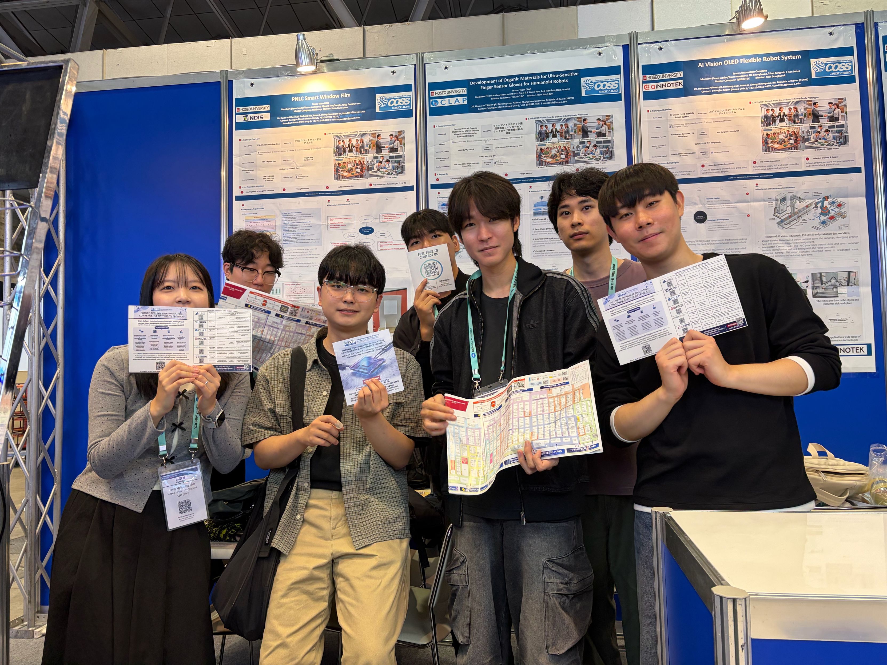
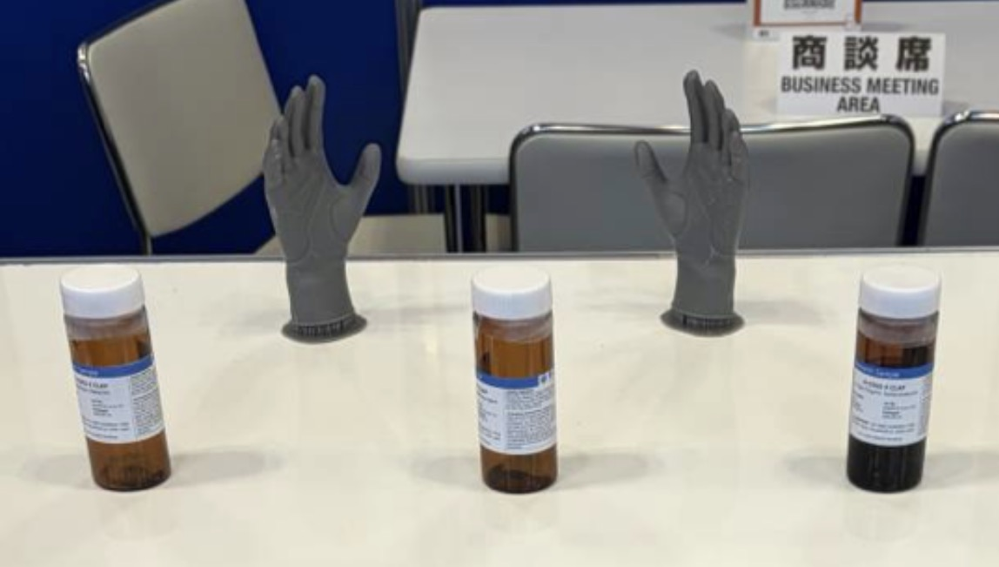

# FINETECH JAPAN 2026 · 손가락 센서 글로브용 유기 소재 연구

**참여:** 호서대학교 × ㈜클랩 산학 프로젝트 Team CLAP 팀원, 서지혜

**기간:** 2026년 6월~9월 프로젝트, 9월 30일~10월 2일 FINETECH JAPAN 전시

휴머노이드 로봇의 손가락에 적용할 유연 센서 글로브를 주제로 유기전자 소재와 잉크젯 직접 인쇄 공정을 검토했습니다. 손가락의 접촉 위치와 압력 변화를 안정적으로 감지하면서 반복 굽힘을 견디는 구조가 연구 목표였습니다.

## 기술 검토

### 1. 센서 요구 조건

- 손가락별 미세 접촉 신호를 구분해 물체 파지에 필요한 위치·압력 정보를 얻는 방향을 정리했습니다.
- 관절처럼 변형이 집중되는 부위의 센서 위치와 배선을 고려하고, 반복 굽힘 뒤에도 신호가 유지되어야 한다는 평가 조건을 세웠습니다.

### 2. 잉크젯 인쇄와 박막 품질

- 멘토링 자료에서 DPP 계열 p형 유기반도체, 유연 절연체 SBS, UV 가교제 Bis-Azide의 역할과 인쇄·패터닝 가능성을 검토했습니다.
- 필요한 위치에만 재료를 토출하는 마스크 없는 직접 인쇄를 검토했습니다. 포토레지스트·식각액이 유기반도체 계면에 닿지 않는 공정 설계와 재료 사용량 절감이 핵심입니다.
- 잉크의 점도·표면장력, 액적 크기·간격, 기판 젖음성, 건조 조건이 패턴 번짐과 박막 두께·균일도에 미치는 영향을 정리했습니다.
- 액적이 서로 연결되지 않거나 건조 중 재료가 가장자리로 몰리면 전기적 특성의 재현성이 낮아질 수 있어, 재료 조성과 공정 조건을 함께 관리해야 한다고 판단했습니다.

### 3. 적층 계면과 실제 사용 환경

- 전극·유전체·유기반도체층·기판 사이의 접착과 이전 공정층의 손상 가능성을 검토했습니다.
- 반복 변형에 따른 박리·균열, 계면의 수분·불순물 유입, 손가락 관절 부위의 배선 보호를 설계 검토 항목으로 제시했습니다.

### 4. 제조 재현성과 전시 경험

- FINETECH JAPAN에서 소재가 제품으로 이어지려면 공정 온도·압력·점도·냉각·건조 조건과 제작 이력을 함께 관리해야 한다는 점을 조사했습니다.
- 호서대학교 공동 부스에서는 영문 포스터와 설명 자료를 사용해 연구 배경, 소재, 잉크젯 공정, 센서 적용 가능성을 관람객에게 전달하고 질문을 팀과 공유했습니다.

## 전시 자료

전시 포스터는 연락처를 가린 공개용 사본입니다. 포스터의 FoD와 μ-LED 이미지는 ㈜클랩의 OTFT 응용 데모입니다.

| 호서대학교 전시 부스 | 전시 현장 팀 사진 |
| --- | --- |
|  |  |

